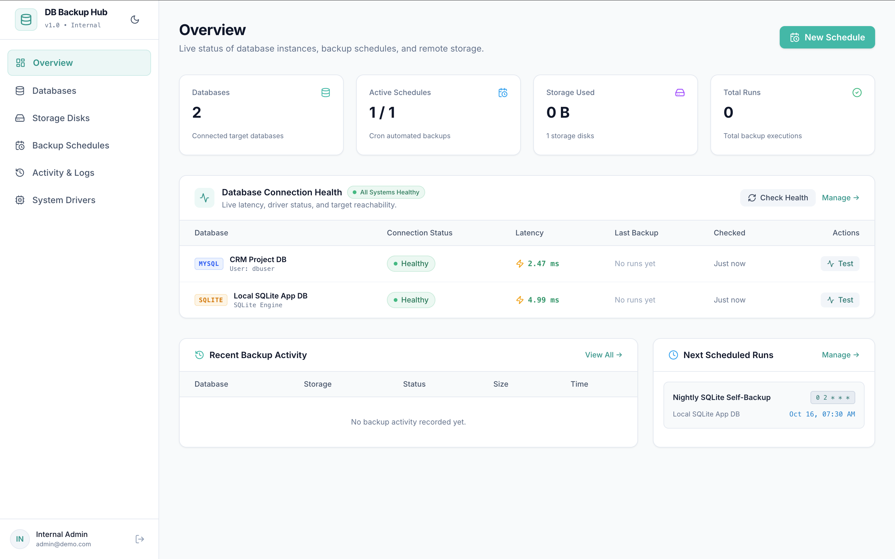

<p align="center">
  <h1 align="center">DB Backup Manager</h1>
  <p align="center">
    <strong>Self-hosted, automated database backup management system with modern web interface, multi-database support, flexible cloud storage destinations, retention policies, and real-time execution monitoring.</strong>
  </p>
</p>

<p align="center">
  <a href="LICENSE"></a>
  <a href="https://php.net"></a>
  <a href="https://laravel.com"></a>
  <a href="https://vuejs.org"></a>
  <a href="https://tailwindcss.com"></a>
</p>

---

## Overview



**DB Backup Manager** is an open-source, full-stack application designed to take the headache out of database disaster recovery. It provides an intuitive single-page dashboard to register database connections, configure local and remote cloud storage targets, schedule recurring backups using standard cron syntax with timezone awareness, enforce retention rules, and track execution logs and downloads.

---

## Features

### 🗄️ Multi-Database Support
Dump and compress databases across different engines using native client dump utilities:
* **MySQL** (via `mysqldump` or `mariadb-dump`)
* **MariaDB** (via `mariadb-dump` or `mysqldump`)
* **PostgreSQL** (via `pg_dump`)
* **SQLite** (atomic file copy & backup)
* **MongoDB** (via `mongodump` compressed archives)

### ☁️ Flexible Storage Destinations
Stream and store your encrypted or compressed backups anywhere:
* **Local Disk & NAS**: Dedicated local storage paths.
* **Amazon S3 & S3-Compatible**: AWS S3, Cloudflare R2, MinIO, DigitalOcean Spaces, Wasabi, Backblaze B2.
* **SFTP / SSH**: Secure remote transfer with password or RSA/ED25519 private key authentication.
* **Azure Blob Storage**: Native Azure Blob REST integration with shared key authorization.

### ⏱️ Automated Scheduling & Retention Policies
* **Cron Scheduling**: Standard 5-field cron syntax (`0 2 * * *`, `*/30 * * * *`) with per-schedule custom timezone support.
* **Retention by Count**: Automatically keep the last *N* backups and safely prune older dumps from remote storage.
* **Retention by Days**: Automatically delete completed backups older than a defined threshold of days.
* **Manual One-Click Triggers**: Instantly dispatch a backup on demand without modifying scheduled intervals.

### 🛡️ Enterprise Concurrency & Deduplication Safeguards
* **Atomic Mutex Locks**: Uses cache locks to prevent race conditions when running redundant scheduler workers.
* **In-Minute Deduplication**: Guarantees a schedule cannot accidentally be executed multiple times within the same minute window.
* **Overlap Protection**: Skips dispatch if a previous backup job for the same schedule is still pending or running.

### 📊 Real-Time Auditing & Monitoring
* **Live Status Tracking**: Monitor jobs through `pending`, `running`, `completed`, and `failed` states.
* **Metrics**: Recorded dump duration (seconds) and compressed payload file size.
* **Output Traces**: Full terminal outputs and stack traces logged on failures.
* **Direct Downloads**: One-click direct streaming download of completed backup archives.
* **Connectivity Health Checks**: Test database connections and storage credentials before saving.

---

## Prerequisites

Before setting up DB Backup Manager, ensure your host machine or server has:

1. **PHP >= 8.3** with the following extensions:
   * `pdo`, `pdo_mysql` (or `pdo_pgsql` / `pdo_sqlite`), `curl`, `mbstring`, `openssl`, `zip`, `fileinfo`
2. **Composer >= 2.x**
3. **Node.js >= 18.x** and **npm**
4. **Database Server**: MySQL 8.x, MariaDB, PostgreSQL, or SQLite to store the manager's internal state.
5. **Database Client Binaries**: To dump remote or local databases, install the corresponding command-line tools on the manager server:
   * **MySQL / MariaDB**: `mysql-client` or `mariadb-client` (`mysqldump` / `mariadb-dump`)
   * **PostgreSQL**: `postgresql-client` (`pg_dump`)
   * **MongoDB**: `mongodb-database-tools` (`mongodump`)

> [!TIP]
> **Debian / Ubuntu Installation of Binaries:**
> ```bash
> sudo apt-get update
> sudo apt-get install -y default-mysql-client postgresql-client
> ```
> **macOS (Homebrew):**
> ```bash
> brew install mysql-client libpq mongodb-community-shell
> ```

---

## Installation & Setup

Follow these steps to set up and run DB Backup Manager locally or on a server:

### 1. Clone Repository
```bash
git clone https://github.com/softwarefuels/db-backup-manager.git
cd db-backup-manager
```

### 2. Install PHP & Node Dependencies
```bash
composer install
npm install
```

### 3. Configure Environment
Copy the example environment configuration:
```bash
cp .env.example .env
php artisan key:generate
```

Open `.env` and configure your database connection for the manager itself:
```ini
APP_NAME="DB Backup Manager"
APP_ENV=production
APP_DEBUG=false
APP_URL=http://localhost:8000

# Manager Database
DB_CONNECTION=mysql
DB_HOST=127.0.0.1
DB_PORT=3306
DB_DATABASE=db_backup_manager
DB_USERNAME=your_db_user
DB_PASSWORD=your_db_password

# Queue & Cache (Required for async backup execution & scheduler locks)
QUEUE_CONNECTION=database
CACHE_STORE=database
```

### 4. Run Migrations
Create the necessary database tables:
```bash
php artisan migrate --force
```

### 5. Build Frontend Assets
Compile the Vue 3 & Tailwind CSS frontend:
```bash
npm run build
```

---

## Running the Application

To make the application fully operational, **three components** must be running:

```
┌─────────────────────────┐     ┌─────────────────────────┐     ┌─────────────────────────┐
│     1. Web Server       │     │     2. Queue Worker     │     │      3. Scheduler       │
│  Serves the UI & API    │     │   Executes Backup Dumps │     │ Checks Cron & Dispatches│
└─────────────────────────┘     └─────────────────────────┘     └─────────────────────────┘
```

### Option A: Local Development

For local development and testing, you can run all components concurrently using Composer:

```bash
composer run dev
```

Alternatively, run each process in separate terminal tabs:
```bash
# Terminal 1: Web Server
php artisan serve

# Terminal 2: Queue Worker (Processes dumps asynchronously)
php artisan queue:work --timeout=7200

# Terminal 3: Scheduler (Triggers due backups every minute)
php artisan schedule:work

# Terminal 4: Frontend Vite Dev Server (Hot module reloading)
npm run dev
```

Visit **`http://localhost:8000`** in your browser. On your first visit, you will be prompted to register the administrator account.

---

### Option B: Production Deployment

In a production environment:

#### 1. Configure Web Server (Nginx)
Point your web server's document root to the `public/` directory with standard PHP-FPM configuration.

#### 2. Configure System Cron (Scheduler)
Add a single cron entry on your server to run the scheduler once every minute:
```bash
crontab -e
```
Add the following line:
```bash
* * * * * cd /path/to/db-backup-manager && php artisan schedule:run >> /dev/null 2>&1
```

> [!IMPORTANT]
> Always use `php artisan schedule:run` in system cron for production. Do not run multiple uncoordinated `php artisan schedule:work` background services.

#### 3. Configure Supervisor (Queue Worker)
Backups run asynchronously via Laravel Queues so that large database dumps do not block web requests.

Install and configure **Supervisor** (`/etc/supervisor/conf.d/backup-worker.conf`):
```ini
[program:backup-worker]
process_name=%(program_name)s_%(process_num)02d
command=php /path/to/db-backup-manager/artisan queue:work database --sleep=3 --tries=3 --max-time=3600 --timeout=7200
autostart=true
autorestart=true
stopasgroup=true
killasgroup=true
user=www-data
numprocs=2
redirect_stderr=true
stdout_logfile=/path/to/db-backup-manager/storage/logs/worker.log
stopwaitsecs=7200
```

Apply and start the worker:
```bash
sudo supervisorctl reread
sudo supervisorctl update
sudo supervisorctl start backup-worker:*
```

#### 4. Cache Configurations for Performance
```bash
php artisan config:cache
php artisan route:cache
php artisan view:cache
```

---

## Artisan Commands

| Command | Description |
| :--- | :--- |
| `php artisan backup:dispatch` | Evaluates all active schedules and dispatches due backup jobs. |
| `php artisan backup:dispatch --force` | Force-dispatches all enabled backup schedules immediately, bypassing cron schedules. |
| `php artisan schedule:run` | Executes Laravel's scheduled commands (invoked by system cron). |
| `php artisan queue:work --timeout=7200` | Starts the queue worker process to execute pending backup jobs. |
| `php artisan test` | Runs the automated PHPUnit feature and unit test suites. |

---

## Testing

Run the test suite using PHPUnit:
```bash
php artisan test
```

Or run code formatting checks with Laravel Pint:
```bash
vendor/bin/pint --format agent
```

---

## Contributing

Contributions, bug reports, and pull requests are warmly welcomed! Please feel free to open an issue or submit a pull request on GitHub.

1. Fork the Project
2. Create your Feature Branch (`git checkout -b feature/AmazingFeature`)
3. Commit your Changes (`git commit -m 'Add some AmazingFeature'`)
4. Push to the Branch (`git push origin feature/AmazingFeature`)
5. Open a Pull Request

---

## License

This project is open-source software licensed under the **[Apache License 2.0](LICENSE)**.
